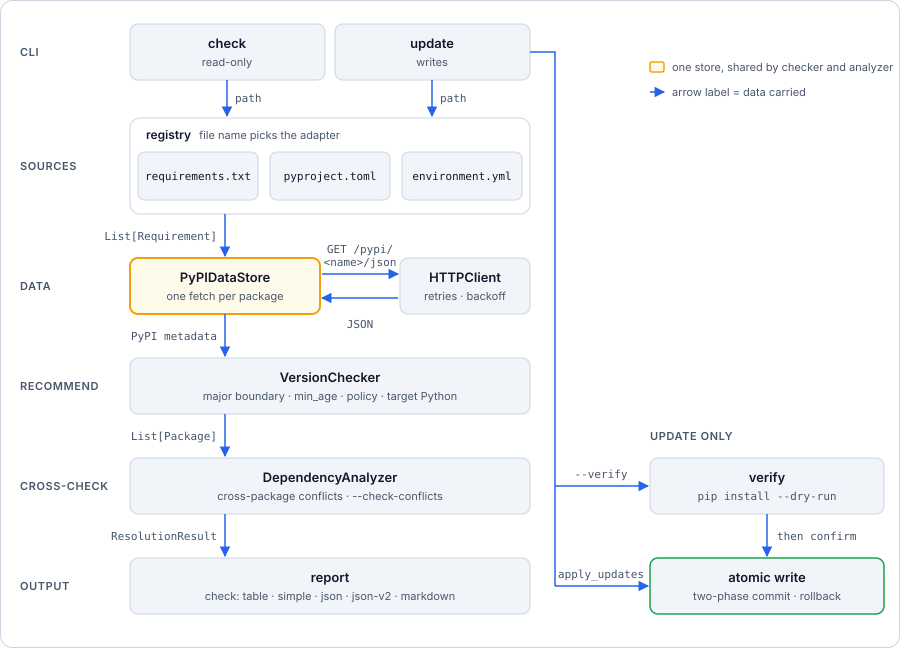
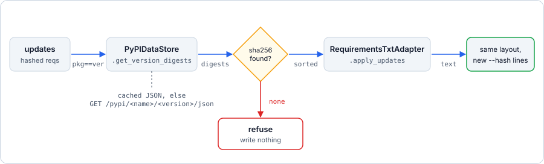
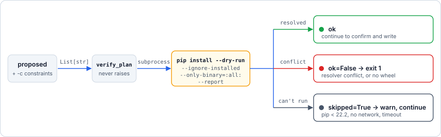

# Architecture

Contributor-facing map of the codebase: what each module owns, how a request flows through it,
and where to make a given change.

This document is optimised for navigating the source. For the design rationale, concurrency model
and algorithm detail, see the
[architecture deep dive](https://github.com/rahulkaushal04/depkeeper/blob/main/docs/concepts/architecture.md).

---

## Shape of the system

depkeeper is a synchronous CLI wrapped around an asynchronous core. Each command builds an event
loop with `asyncio.run`, performs all network I/O inside it, then returns to synchronous code to
render output or write files.

There is no daemon, no persistent state and no cache directory. A process starts cold and exits
cold. Configuration is read from the first `depkeeper.toml` (or `pyproject.toml` with a
`[tool.depkeeper]` table) found from the working directory upwards, stopping at the repository
root (`.git`) or, without one, at `$HOME`.

<p align="center"></p>

<p align="center"><em>check stops at the report; update adds a pip dry-run and a two-phase atomic write.</em></p>

---

## Module responsibilities

| Module | Owns | Must not |
|---|---|---|
| `cli.py` | Click group, global options, config loading, logging setup, top-level exit codes (`130` on Ctrl-C) | Contain business logic |
| `commands/check.py` | Read-only pipeline, five output formats, `--fail-on` gate, stream separation | Write to the filesystem |
| `commands/update.py` | Filtering (`--packages`, `--ignore`, `--max-update`), update plan, confirmation, `--refresh-hashes`, `--verify`, two-phase commit, rollback | Recompute recommendations |
| `commands/_report.py` | Shared by both commands: `--python-version` / `--min-age` options, target-Python resolution, `Row`, release links, `json-v2` envelope, markdown report | Do network I/O or write files |
| `core/sources/base.py` | `SourceAdapter` interface (`can_handle`, `parse`, `apply_updates`, `requires_python`) | Touch the disk when updating |
| `core/sources/registry.py` | Map a path to an adapter, discover files in a directory, parse many files into one list | Know any one format |
| `core/sources/requirements_txt.py` | Adapter over `core/parser.py`; also the fallback for unknown file names (for example `*.in`) | |
| `core/sources/pyproject_toml.py` | PEP 621, PEP 735 groups, `build-system.requires`, Poetry; minimal in-place edits by character span | Reformat the file |
| `core/sources/conda_yaml.py` | `environment.yml` `dependencies:` and `pip:` lists; conda names are approximate | Check conda channels |
| `core/parser.py` | Text → `Requirement`, `-r`/`-c` directives, provenance, BOM handling | Perform network I/O |
| `core/data_store.py` | PyPI metadata cache (versions, `upload_times`, `project_urls`), per-version dependencies and file digests, request coalescing, concurrency limit | Cache failures |
| `core/checker.py` | Per-package recommendation: major boundary or calver, Python filter, constraints, pre-release rule, per-package policy, `min_age` cooldown | Know about other packages |
| `core/dependency_analyzer.py` | Iterative cross-package resolution, conflict records; reuses the checker's rules when it picks a version | Cross a major boundary |
| `core/verify.py` | `pip install --dry-run --only-binary=:all: --report` over the proposed set; never raises | Install anything or build an sdist |
| `models/` | Data + behaviour: version state, status ladder, serialisation, line rendering | Do any I/O |
| `utils/http.py` | Retries, backoff, rate limiting, 429 handling, response and redirect limits | Know about PyPI schemas |
| `utils/filesystem.py` | Atomic writes, backups, path confinement | Know about requirements syntax |
| `utils/console.py` | Per-stream Rich consoles, tables, prompts, `NO_COLOR` | Emit diagnostics (that is `logger`) |
| `utils/version_utils.py` | Version parsing, `detect_versioning`, update labels, `gating_type` / `update_rank` | Do any I/O |
| `utils/naming.py` | PEP 503 canonicalisation — **the** single source of truth | Be reimplemented anywhere else |
| `config.py` | TOML discovery, parsing, strict validation, `PackagePolicy`, `parse_duration` | Read CLI state |
| `constants.py` | Every tunable literal | Contain logic |

### Layering

```text
commands  →  core  →  models  →  utils
    └──────────────────────────────┘
```

Dependencies point rightwards only. `utils` depends on nothing inside depkeeper except
`constants`, `exceptions` and other `utils`.

---

## Request flow

### check and update

Both commands share stages 1–4.

| # | Stage | Component | Notes |
|---|---|---|---|
| 1 | Resolve target | `registry.default_target`, `resolve_targets` | A file, a directory (discovery), or the default `requirements.txt` |
| 2 | Parse | `registry.parse_targets` → adapters | Every file goes into one `Requirement` list, each tagged with `source_file` and `source_format`. `requirements.txt` also follows `-r`/`-c` |
| 3 | Pick target Python | `_report.resolve_target_python` | `--python-version`, then config `python_version`, then the source's `requires-python` (lowest supported minor), then the running interpreter |
| 4 | Prefetch | `PyPIDataStore.prefetch_packages` | One concurrent burst; one HTTP request per unique package |
| 5 | Recommend | `VersionChecker.from_config` + `check_packages` | Applies policy, calver, `min_age` and target Python. Served from the prefetch cache. CLI values win over config |
| 6 | Resolve | `DependencyAnalyzer.resolve_and_annotate_conflicts` | Optional (`--check-conflicts`); gets the same `target_python` and `checker`; mutates `Package` objects in place |
| 7 | Report | `commands/_report.py` | `make_rows`, then `table` / `simple` / `json` / `json-v2` / `markdown` |

`check` ends at stage 7. Exit code is `4` if any lookup failed, else `3` if `--fail-on` tripped
(`gating_type` makes calver `year` and `month` count as `minor`), else `0`.

`update` continues:

| # | Stage | Component | Notes |
|---|---|---|---|
| 8 | Plan | `_find_updates` | Drops ignored packages, `--packages` misses, updates above `--max-update`, and no-op rewrites |
| 9 | Hashes | `_fetch_hash_digests` | Only with `--refresh-hashes` and hashed requirements. No digests → nothing is written |
| 10 | Verify | `core/verify.py` | Only with `--verify`. A conflict exits `1`; a missing or old pip is a warning |
| 11 | Confirm | `_confirm_update` | Declined or aborted → exit `1` (`130` on Ctrl-C) |
| 12 | Write | `_apply_updates` | Group edits by `source_file`; each file's adapter returns the new text; all files render before any is written; commit atomically; roll back on failure |

`update` exits `4` when some package could not be looked up (the rest is still applied).

### refresh-hashes data flow

<p align="center"></p>

<p align="center"><em>No digests means nothing is written.</em></p>

Only `sha256` is written. Other hash types are replaced with a warning. `--refresh-hashes` and
`--allow-hash-removal` are mutually exclusive (usage error, exit `2`).

### verify data flow

<p align="center"></p>

<p align="center"><em>A conflict stops the update; an unavailable pip only warns.</em></p>

pip's own index and credential variables are kept so private indexes still work. Variables that
would change what is resolved are removed. Credentials in output are redacted.

---

## Key design decisions

| # | Decision | Rationale |
|---|---|---|
| D1 | One `PyPIDataStore`, shared by checker and analyzer | Guarantees one HTTP request per package; makes the analyzer's ≤100 passes nearly free; both components see a consistent snapshot |
| D2 | Per-key in-flight map, not only a semaphore | A semaphore admits *N* coroutines, so "check cache then fetch" inside it is not mutually exclusive. Waiters await the same task via `asyncio.shield` and consume no slot |
| D3 | Major boundary applied at candidate-selection time | Applied in three independent places, so no code path — including the resolver's rescue paths — can produce a cross-major recommendation |
| D4 | Split specifiers into *floor* and *retained* | Only the floor is rewritten; retained specs are fed forward into candidate selection so an unsatisfiable line is never even proposed |
| D5 | Status computed in the model, not the renderer | `get_display_data()` / `get_status_summary()` keep renderers from disagreeing |
| D6 | One Rich `Console` **per stream** | Keeps stdout exclusively for machine-readable payloads; `print_error` defaults to stderr |
| D7 | `Requirement.source_file` provenance | A requirement from `-r included.txt` keeps the included file's line numbers; matching on line number alone would corrupt the parent file |
| D8 | Two-phase commit for multi-file writes | All files render before any is written; a later failure rolls back earlier commits |
| D9 | One adapter interface for all file formats | `check` and `update` never branch on format; a directory becomes one requirement list and one report |
| D10 | Policy is applied in `VersionChecker` and reused by the analyzer | A conflict backport cannot bypass `hold`, `max_update`, `min_age` or the pre-release rule |
| D11 | Calver has no major boundary; its labels map onto semver ranks (`gating_type`) | `--fail-on` and `--max-update` mean the same for every package |

Failures are never cached at the data-store level, because `prefetch_packages` swallows errors and
the checker legitimately retries afterwards. Negative caching belongs to the consumer — the
analyzer keeps a per-run set of unreachable names to avoid a retry storm across resolution passes.

---

## Data model

| Type | Represents | Notable fields |
|---|---|---|
| `Requirement` | One declared dependency (a requirements line, a TOML entry, a conda item) | `specs`, `extras`, `markers`, `url`, `editable`, `hashes`, `comment`, `line_number`, `span`, `source_file`, `source_format`, `approximate` (conda). Provenance fields are excluded from equality |
| `Package` | A requirement enriched with PyPI metadata and decisions | `current_version`, `latest_version`, `recommended_version`, `conflicts`, `metadata`, `versioning`, `held`, `ignored`, release age |
| `Conflict` | One violated dependency requirement | `source_package`, `source_version`, `target_package`, `required_spec`, `conflicting_version` — frozen, so it can be deduplicated |
| `ResolutionResult` | The outcome of resolution | `resolved_versions`, `iterations_used`, `converged`, `packages_with_conflicts` |

**Invariant:** `Package.recommended_version == ResolutionResult.resolved_versions[name].resolved`.
`ResolutionResult` is the single source of truth; the version reported is the version written.

---

## Source adapters

`core/sources/` hides each file format behind `SourceAdapter`:

- `can_handle(path)`: cheap check, usually on the file name.
- `parse(path)`: return `Requirement` objects. Non-line formats also set `span`, the character
  range of the version specifier.
- `apply_updates(text, updates, pin=, allow_hash_removal=, path=)`: return the new full text.
  Edit in place; change only specifier characters. Raise rather than return a partial result.
- `requires_python(path)`: optional declared Python constraint.
- `patterns`, `fallback`, `has_dependencies`: used for directory discovery.

`registry.py` keeps an ordered list of adapters. Order decides both matching and discovery
order. An adapter with `fallback = True` takes files no other adapter claims. Adapters never
write to disk: the command owns atomic writes, backups and rollback.

`update` groups edits by `Requirement.source_file`, so a requirement pulled in by `-r` is edited
in its own file. Adapters refuse to apply an edit when the text at a span changed since parsing.

---

## Concurrency and limits

All limits are module constants and are **not** configurable at runtime.

| Bound | Value | Location |
|---|---|---|
| HTTP connections in flight | 10 | `HTTPClient(max_concurrency=…)` |
| Distinct PyPI fetches in flight | 10 | `PyPIDataStore(concurrent_limit=…)` |
| Request timeout | 30 s per attempt, plus a total deadline per request | `constants.DEFAULT_TIMEOUT`, `HTTPClient(total_timeout=…)` |
| Response body | 20 MB | `http.MAX_RESPONSE_BYTES` |
| Redirects | https on PyPI hosts only | `HTTPClient._send_once` |
| Retries per request | 3 (4 attempts) | `constants.DEFAULT_MAX_RETRIES` |
| `429` retries | 5, honouring `Retry-After` | `HTTPClient._max_429_retries` |
| Resolution passes | 100 | `_MAX_RESOLUTION_ITERATIONS` |
| Source candidates per conflict | 50 | `_MAX_SOURCE_CANDIDATES` |
| Maximum input file size | 10 MB | `constants.MAX_FILE_SIZE` |

The pipeline is single-threaded. Locks in `utils/console.py` and `utils/logger.py` protect
memoised singletons against concurrent first use, not concurrent commands.

`DependencyAnalyzer(concurrent_limit=…)` constructs a semaphore that is currently unused — all its
I/O goes through the data store's limit. Treat the parameter as reserved.

---

## Error propagation

```text
DepKeeperError                    message + structured `details`
├── ParseError                    line_number, line_content, file_path
├── ConfigError                   config_path, option
├── FileOperationError            file_path, operation, original_error
└── NetworkError                  url, status_code, response_body
    └── PyPIError                 package_name
```

- `PyPIError` subclasses `NetworkError`, so one `except NetworkError` covers 404s, timeouts,
  `429` exhaustion and 5xx. Catch the broader class.
- Per-package network failures are **absorbed**: the checker returns an *unavailable stub*, the
  analyzer negatively caches the name, and the run completes. One dead package never aborts a
  report.
- Everything else surfaces at the command boundary, prints via `print_error` (stderr), exits `1`.

---

## Operational characteristics

| Concern | Behaviour |
|---|---|
| **Reliability** | Atomic replace (temp → `fsync` → `os.replace`), mode preservation, symlink following, bounded retries for transient Windows lock errors, two-phase commit with rollback, optional backups. |
| **Scalability** | Cost is one HTTP request per unique package, plus one per `(package, version)` pair during conflict scanning. Bounded at 10 concurrent connections; runtime is network-dominated. `--no-check-conflicts` removes the dominant cost. |
| **Caching** | In-memory, per process. Failed requests are remembered by `HTTPClient` for 30 s so one run does not wait out the same backoff twice. No TTL, no cross-run reuse, no offline mode — correctness over speed, since a stale cache produces a wrong recommendation. |
| **Security** | Never imports, installs, builds or executes analysed packages. HTTPS to `pypi.org` only, verification always on. `--verify` runs pip with `--only-binary=:all:`, so no sdist build hook runs. Outbound data is package names in URLs. See [SECURITY.md](SECURITY.md). |
| **Observability** | Structured exceptions with `details`; `-v`/`-vv` to INFO/DEBUG; all records on stderr under the `depkeeper` logger namespace. |
| **Idempotency** | A rewrite that would produce a byte-identical line is skipped, so repeated runs converge. |

---

## Deliberate omissions

| Not present | Rationale |
|---|---|
| Persistent cache | A stale cache produces wrong recommendations |
| Lock file | depkeeper does not own the environment; `--pin` gives lockfile semantics in place |
| Transitive graph resolution | depkeeper validates what you declared; `pip` resolves |
| Parser plugin system | The parser is intentionally monolithic and pip-shaped |
| Private index support | Only `pypi.org` is queried; `--index-url` lines are parsed and ignored (`--verify` does honour pip's own index settings) |

Full list with workarounds:
[Known limitations](https://github.com/rahulkaushal04/depkeeper/blob/main/docs/reference/limitations.md).

---

## Where to make a change

| Goal | Start at | Also read |
|---|---|---|
| Add a file format | New `core/sources/<format>.py` subclassing `SourceAdapter`; register in `registry._register_builtins`; tests under `tests/test_sources/` (include a "no-op update leaves bytes identical" case). Steps are in the `core/sources/base.py` docstring | D9 |
| Add an output format | Add the name to `FORMATS` in `commands/check.py` and a renderer in `commands/_report.py`. Keep stdout machine-only: status text goes to stderr for every format except `table` (`HUMAN_READABLE_FORMAT`) | D5, D6 |
| Add a per-package policy key | `PackagePolicy` and `_parse_packages` in `config.py`; enforce it in `VersionChecker` (`restrict_versions` / `_candidates`) so the analyzer inherits it | D10 |
| Add a config key | `config.py`, `constants.py`; wire a CLI override in the command if needed | [Configuration options](https://github.com/rahulkaushal04/depkeeper/blob/main/docs/reference/configuration-options.md) |
| Add a CLI flag | `commands/check.py` or `commands/update.py`; share helpers in `commands/_report.py` | [Extending](https://github.com/rahulkaushal04/depkeeper/blob/main/docs/contributing/extending.md) |
| Change which version is chosen | `core/checker.py` | [Version recommendation](https://github.com/rahulkaushal04/depkeeper/blob/main/docs/concepts/version-recommendation.md) |
| Change conflict behaviour | `core/dependency_analyzer.py` | [Conflict resolution](https://github.com/rahulkaushal04/depkeeper/blob/main/docs/concepts/conflict-resolution.md) |
| Accept new requirements.txt syntax | `core/parser.py`, `constants.py` | [Requirements parsing](https://github.com/rahulkaushal04/depkeeper/blob/main/docs/concepts/requirements-parsing.md) |
| Change how files are written | `commands/update.py`, `utils/filesystem.py` | [Write safety](https://github.com/rahulkaushal04/depkeeper/blob/main/docs/concepts/write-safety.md) |
| Change network behaviour | `utils/http.py` | [Operations](https://github.com/rahulkaushal04/depkeeper/blob/main/docs/guides/operations.md) |

Before changing anything under `core/`, read the [Guarantees](#guarantees) below and
[CONTRIBUTING.md](CONTRIBUTING.md).

---

## Guarantees

- **Exit codes:** `0` ok, `1` error (also a declined prompt or a `--verify` conflict), `2` usage,
  `3` `check --fail-on` tripped, `4` a PyPI lookup failed (wins over `3`), `130` interrupted.
- **Machine output is clean:** `json`, `json-v2`, `markdown` and `simple` put only the payload on
  stdout. Status, warnings and errors go to stderr.
- **No cross-major recommendation** for semver packages, on any code path. Calver packages are the
  only exception, by design.
- **Policy is never bypassed:** `hold`, `ignore`, `max_update`, `min_age` and the pre-release rule
  also bind conflict resolution.
- **Writes are all-or-nothing:** every file renders before any is written; a failure or Ctrl-C
  rolls back files already committed. A file changed on disk since it was read is refused.
- **Formatting survives:** adapters edit only specifier characters; comments, order, quoting and
  line endings stay.
- **Nothing from PyPI is executed:** no import, install or sdist build, including under `--verify`.
- **One name rule:** all package names go through `utils/naming.py`.
