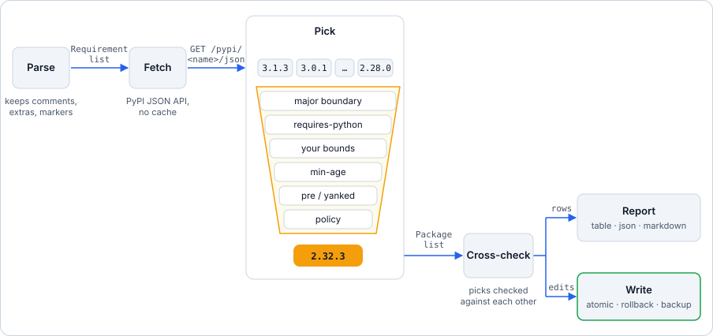

<p align="center"></p>

<h1 align="center">depkeeper</h1>

<p align="center"><strong>Safe dependency updates for requirements.txt, pyproject.toml and conda environment.yml.</strong></p>

<p align="center">
  <a href="https://github.com/rahulkaushal04/depkeeper/actions/workflows/tests.yml"></a>
  <a href="https://codecov.io/gh/rahulkaushal04/depkeeper"></a>
  <a href="https://pypi.org/project/depkeeper/"></a>
  <a href="https://pypi.org/project/depkeeper/"></a>
  <a href="LICENSE"></a>
  <a href="https://github.com/rahulkaushal04/depkeeper/blob/main/docs/index.md"></a>
</p>

<p align="center">
  <a href="#install">Install</a> ·
  <a href="#quick-start">Quick start</a> ·
  <a href="#commands">Commands</a> ·
  <a href="#configuration">Configuration</a> ·
  <a href="#use-it-in-ci">CI</a> ·
  <a href="#limitations">Limitations</a> ·
  <a href="https://github.com/rahulkaushal04/depkeeper/blob/main/docs/index.md">Docs</a>
</p>

---

depkeeper is a command-line tool. It reads your dependency file, asks PyPI what is newer, and picks the
newest version that is **safe** for each package. Then it edits the file in place.

It keeps the ranges you wrote. It never jumps a major version. It does not install anything.

## Why

`pip list --outdated` shows the latest release. That is often a new major version that breaks your build.

depkeeper answers one question:

> What is the newest version of each dependency I can take without crossing a major version, without
> breaking Python compatibility, without violating the constraints I wrote, and without conflicting with
> the other packages in my file?

|  | `pip list --outdated` | pip-tools | depkeeper |
|---|---|---|---|
| Shows newer versions | ✓ (latest only) | – | ✓ (latest and a safe target) |
| Respects major-version boundaries | – | – | ✓ |
| Edits your existing file, keeps your ranges | – | regenerates from `.in` | ✓ |
| Needs a new file format or lock file | no | `.in` files | no |
| Resolves the full transitive graph | at install time | ✓ | – (see [Limitations](#limitations)) |

depkeeper does not replace a resolver. Run `pip install` and your tests after every update.

## Features

**Safe recommendations**
- Stays inside the current major version (`1.x` is never moved to `2.x`).
- Skips releases whose `requires_python` excludes your target Python.
- Keeps upper bounds, exclusions and `~=` ranges. Only the lower bound moves.
- Never recommends pre-releases or yanked releases.
- Calendar-versioned packages (such as `certifi`) are detected and labelled `year`, `month` or `patch`.
- Cross-checks the recommended versions against each other and backs off on conflicts.

**File formats**
- `requirements*.txt` (including `-r` and `-c` files)
- `pyproject.toml` (PEP 621, PEP 735 dependency groups, `build-system.requires`, Poetry), edited without touching comments or formatting
- conda `environment.yml` (`dependencies:` and `pip:` lists)

**Policy and cooldown**
- `--min-age 7d` skips versions released too recently.
- `hold`, `ignore` and `max_update` per package, in config.
- `--ignore PKG` and `--max-update {patch,minor,major}` on the command line.

**CI gating**
- `check --fail-on {none,updates,minor,major}` exits `3` when updates at that level exist.
- Exit `4` when a package could not be looked up. A failed lookup is never reported as "up to date".

**Safe writes**
- Atomic file replacement, with rollback for multi-file updates.
- `--backup` saves a timestamped copy of every file it changes.
- Refuses to drop `--hash` lines unless you say so. `--refresh-hashes` regenerates them from PyPI digests.
- Aborts if a file changed on disk since it was read.

**Verify before writing**
- `update --verify` asks pip's resolver whether the new set resolves. On a conflict, nothing is written.

**Output formats** (`check --format`)

| Format | Use it for |
|---|---|
| `table` | Reading in a terminal (default) |
| `simple` | Plain lines, easy to grep |
| `json` | Bare array of packages |
| `json-v2` | Versioned envelope with file, line, age and links |
| `markdown` | A report for a PR body or CI summary |

For `simple`, `json`, `json-v2` and `markdown`, only the payload goes to stdout. Logs and warnings go to
stderr, so `depkeeper -v check -f json | jq` works.

## Install

```bash
python -m pip install depkeeper    # into your project's environment
pipx install depkeeper             # or as an isolated tool
```

Requires Python 3.8 or newer.

> [!IMPORTANT]
> depkeeper only proposes versions that support your **target Python**. It picks that version in this
> order: `--python-version X.Y`, the `python_version` config key, the file's own `requires-python` (or
> conda `python` pin), then the Python that runs depkeeper. If your project targets 3.12 and none of the
> first three is set, run depkeeper on 3.12 or pass `--python-version 3.12`.

```bash
depkeeper --version
```

## Quick start

Start with a small `requirements.txt`:

```text
requests==2.28.0
flask>=2.0,<2.3
click~=8.0
urllib3==1.26.0
```

**1. Look (read-only).** The output below is real, captured on the date of writing. Versions and ages will
differ when you run it.

```console
$ depkeeper check --format simple
[OUTDATED]   requests             2.28.0     → 2.34.2
       released 175 days ago
       Python: installed: >=3.7, <4, latest: >=3.10, recommended: >=3.10
[OUTDATED]   flask                2.0        → 3.1.3      (recommended: 2.2.5)
       released 1283 days ago
       Python: latest: >=3.9, recommended: >=3.7
[OUTDATED]   click                8.0        → 8.5.0
       released 71 days ago
       Python: latest: >=3.10, recommended: >=3.10
[OUTDATED]   urllib3              1.26.0     → 2.8.0      (recommended: 1.26.20)
       released 798 days ago
       Python: installed: >=2.7, !=3.0.*, !=3.1.*, !=3.2.*, !=3.3.*, !=3.4.*, <4, latest: >=3.10, recommended: !=3.0.*,!=3.1.*,!=3.2.*,!=3.3.*,!=3.4.*,!=3.5.*,>=2.7
```

Read `recommended` as "what depkeeper will write". `flask` stays on 2.2.5 because of your `<2.3` cap.
`urllib3` stays on 1.x because 2.x is a major jump.

**2. Preview the write.**

```console
$ depkeeper update --dry-run
                                       Update Plan (Dry Run)
┏━━━━━━━━━━┳━━━━━━━━━┳━━━━━━━━━━━━━┳━━━━━━━━┳━━━━━━━━━━━━━━━━━━━━━━━━━━━━━━━━━━━━━━━━━━━━━━━━━━━━━━┓
┃ Package  ┃ Current ┃ New Version ┃ Change ┃ Python Requires                                      ┃
┡━━━━━━━━━━╇━━━━━━━━━╇━━━━━━━━━━━━━╇━━━━━━━━╇━━━━━━━━━━━━━━━━━━━━━━━━━━━━━━━━━━━━━━━━━━━━━━━━━━━━━━┩
│ requests │ 2.28.0  │   2.34.2    │ minor  │ >=3.10                                               │
│ flask    │   2.0   │    2.2.5    │ minor  │ >=3.7                                                │
│ click    │   8.0   │    8.5.0    │ minor  │ >=3.10                                               │
│ urllib3  │ 1.26.0  │   1.26.20   │ patch  │ !=3.0.*,!=3.1.*,!=3.2.*,!=3.3.*,!=3.4.*,!=3.5.*,>=2. │
└──────────┴─────────┴─────────────┴────────┴──────────────────────────────────────────────────────┘
Dry run mode - no changes applied
```

(The real table also prints a `175d old`-style age under each new version. It is trimmed here.)

**3. Apply.**

```console
$ depkeeper update --backup --yes
[OK] Backup saved: requirements.20261106_182111_458701_7f45f023.backup.txt
[OK] Successfully updated 4 package(s)
```

```text
requests==2.34.2
flask>=2.2.5,<2.3
click~=8.5
urllib3==1.26.20
```

Only the lower bounds moved. `<2.3` stayed. `~=` stayed. Add `--pin` if you want exact `==` pins instead.

**4. Test.**

```bash
python -m pip install -r requirements.txt && pytest
```

## Supported files

| File | Read | Written | Notes |
|---|---|---|---|
| `requirements*.txt` | ✓ | ✓ | `-r` includes are followed and rewritten. `-c` constraint files are read, never rewritten. |
| `pyproject.toml` | ✓ | ✓ | PEP 621, PEP 735 groups, `build-system.requires`, Poetry. Comments and layout are kept. |
| conda `environment.yml` | ✓ | ✓ | Conda packages are looked up on PyPI by name. This is approximate. |
| `Pipfile`, `poetry.lock`, `setup.py`, `setup.cfg` | – | – | Not supported. |

Editable installs, VCS URLs, direct URLs and local paths are reported but never changed.

## Commands

```text
depkeeper [-c FILE] [-v|-vv] [--color|--no-color] COMMAND [FILE]
```

Global options go before the command: `depkeeper -v check`. `FILE` defaults to `requirements.txt`.

| Command | What it does |
|---|---|
| `depkeeper check` | Report available updates. Never writes. |
| `depkeeper check --outdated-only` | Hide packages that are up to date. |
| `depkeeper check -f json` | Machine-readable output (`simple`, `json`, `json-v2`, `markdown`, `table`). |
| `depkeeper check --fail-on minor` | Exit `3` if a minor or major update exists. |
| `depkeeper check --min-age 7d` | Ignore versions released in the last 7 days. |
| `depkeeper check --python-version 3.12` | Pick versions that support Python 3.12. |
| `depkeeper check --ignore PKG` | Skip a package (repeatable). |
| `depkeeper update --dry-run` | Show the plan. Write nothing. |
| `depkeeper update -y` | Apply without the confirmation prompt. |
| `depkeeper update --backup` | Save a timestamped backup of every file first. |
| `depkeeper update --verify` | Check with pip's resolver before writing. |
| `depkeeper update --pin` | Write exact `==` pins. |
| `depkeeper update -p NAME` | Update only these packages (repeatable). |
| `depkeeper update --ignore NAME` | Never update these packages (repeatable). |
| `depkeeper update --max-update minor` | Skip updates larger than `minor`. |
| `depkeeper update --refresh-hashes` | Regenerate `--hash` lines for the new version. |
| `depkeeper update --allow-hash-removal` | Update hashed requirements and drop their hashes. |
| `depkeeper update -f markdown` | Print a PR description of the changes (needs `--yes` or `--dry-run`). |

Both commands also accept `--strict-version-matching` and `--check-conflicts / --no-check-conflicts`.
`--refresh-hashes` and `--allow-hash-removal` cannot be used together.

Full flag reference: [CLI commands](https://github.com/rahulkaushal04/depkeeper/blob/main/docs/reference/cli-commands.md).

### Exit codes

| Code | Meaning |
|---|---|
| `0` | Success. Updates being available is **not** an error. |
| `1` | Error (bad file, bad config, write failed, `--verify` found a conflict, hash removal refused). `update` also exits `1` if you decline the prompt or `--packages` matches nothing. |
| `2` | Usage error. |
| `3` | `check --fail-on`: updates at or above the chosen level exist. |
| `4` | A package could not be looked up on PyPI. |
| `130` | Interrupted. |

## Configuration

Put settings in `depkeeper.toml` (table `[depkeeper]`) or in `pyproject.toml` (table `[tool.depkeeper]`).
depkeeper looks in the current directory, then its parents up to the repository root. A command-line flag
always beats the config file.

```toml
# depkeeper.toml
[depkeeper]
min_age = "7d"             # cooldown: skip releases newer than 7 days
fail_on = "minor"          # `check` exits 3 on minor or major updates
python_version = "3.12"    # target Python for compatibility filtering
ignore = ["boto3"]         # never touch these
check_conflicts = true

[depkeeper.packages.django]
max_update = "patch"       # django: patch updates only

[depkeeper.packages.flask]
hold = true                # flask: report, but do not update
```

Keys: `check_conflicts`, `strict_version_matching`, `fail_on`, `ignore`, `python_version`, `min_age`,
`versioning`, `packages`. Unknown keys are an error. Details:
[Configuration options](https://github.com/rahulkaushal04/depkeeper/blob/main/docs/reference/configuration-options.md).

## Use it in CI

`check` exits `0` even when updates exist. Use `--fail-on` to make a pipeline fail on drift. A scheduled
job that fails when a minor or major update is waiting:

```yaml
# .github/workflows/dependency-drift.yml
name: Dependency drift
on:
  schedule:
    - cron: "0 6 * * 1"     # Mondays, 06:00 UTC
  workflow_dispatch:

permissions:
  contents: read

jobs:
  check:
    runs-on: ubuntu-latest
    steps:
      - uses: actions/checkout@v4
      - uses: actions/setup-python@v5
        with:
          python-version: "3.12"
      - run: python -m pip install "depkeeper==X.Y.Z"   # pin to a release you have tested: recommendations are behaviour
      - run: depkeeper check --fail-on minor --min-age 7d
```

The job fails on exit `3` (updates found) and on exit `4` (a lookup failed). To publish a report instead of
failing, drop `--fail-on` and add `--format markdown >> "$GITHUB_STEP_SUMMARY"`.

<details>
<summary>Open an update PR instead</summary>

`update --format markdown` prints a PR body. Pair it with any pull-request action.

```bash
depkeeper update --yes --verify --format markdown > pr-body.md
python -m pip install -r requirements.txt && pytest
```

`--verify` aborts with exit `1` and writes nothing if pip's resolver rejects the new set.
More patterns: [CI/CD integration](https://github.com/rahulkaushal04/depkeeper/blob/main/docs/guides/ci-cd-integration.md).

</details>

## How it works

<p align="center"></p>

<p align="center"><em>Candidate versions pass through six named rules to one pick; only the write branch touches your files.</em></p>

depkeeper is a synchronous CLI around an async core. It keeps no cache and no state between runs.
Design notes: [ARCHITECTURE.md](ARCHITECTURE.md).

## Limitations

- **Not a full resolver.** depkeeper cross-checks the packages you declared using each version's direct
  dependencies. It does not expand the transitive graph. `update --verify` and `pip install` are the
  real test.
- **PyPI only.** `--index-url`, `--extra-index-url` and `--find-links` are parsed and ignored.
  Packages that exist only on a private index show up as errors.
- **Major upgrades are manual.** A floor of `django>=3.2,<5.0` caps at the newest `3.x`. Raise the floor
  yourself, then let depkeeper continue.
- **conda is approximate.** Conda-channel packages are matched to PyPI by name. A missing match is a
  warning, not a failure.
- **No pre-releases.** There is no `--pre` flag.
- **No security scanning.** Use `pip-audit` or similar next to depkeeper.
- **No cache.** Every run fetches metadata again.
- **Hash removal leaves a partly hashed file.** `pip install --require-hashes` rejects that. Prefer
  `--refresh-hashes`.
- **Direct references are never updated.** VCS, URL, local path and editable requirements are reported only.

Full list: [Known limitations](https://github.com/rahulkaushal04/depkeeper/blob/main/docs/reference/limitations.md).

## Documentation

Full docs: **[docs/](https://github.com/rahulkaushal04/depkeeper/blob/main/docs/index.md)**

- [Getting started](https://github.com/rahulkaushal04/depkeeper/blob/main/docs/getting-started/index.md)
- [Concepts](https://github.com/rahulkaushal04/depkeeper/blob/main/docs/concepts/index.md): how versions are recommended, how conflicts are resolved, write safety
- [Guides](https://github.com/rahulkaushal04/depkeeper/blob/main/docs/guides/index.md): checking, updating, configuration, CI/CD, troubleshooting
- [Reference](https://github.com/rahulkaushal04/depkeeper/blob/main/docs/reference/index.md): CLI, config, exit codes, file formats, JSON output
- [CHANGELOG.md](CHANGELOG.md)

## Contributing

Issues and pull requests are welcome. Start with [CONTRIBUTING.md](CONTRIBUTING.md).

```bash
git clone https://github.com/rahulkaushal04/depkeeper.git
cd depkeeper
pip install -e ".[dev,docs]"
python -m pytest tests -q --no-cov
```

Report security problems privately. See [SECURITY.md](SECURITY.md). Please follow the
[Code of Conduct](CODE_OF_CONDUCT.md).

## License

[Apache License 2.0](LICENSE). Copyright 2025-2026 Rahul Kaushal.
