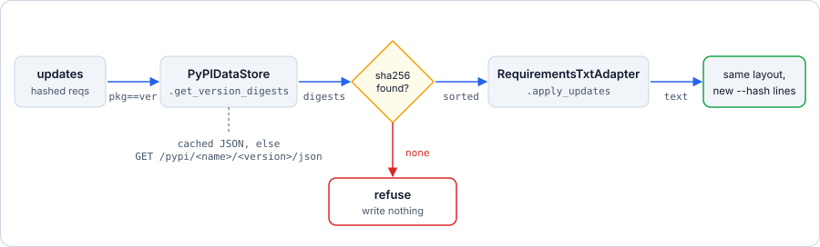
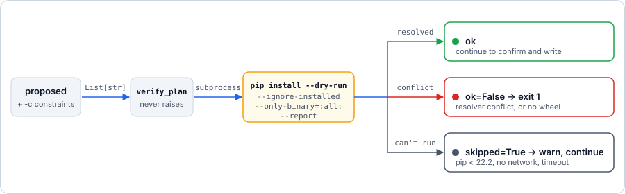

# Architecture

## Overview

depkeeper is a synchronous CLI wrapped around an asynchronous core. Each command builds an event
loop with `asyncio.run`, performs all network I/O inside it, and returns to synchronous code to
render output or write files. There is no daemon, no persistent state and no cache directory: a
process starts cold and exits cold.

---

## Module map

```text
depkeeper/
├── cli.py              Click group: global options, config load, logging setup, exit 130 on Ctrl-C
├── __main__.py         `python -m depkeeper` entry point
├── context.py          DepKeeperContext — per-invocation shared state
├── config.py           TOML discovery, strict validation, PackagePolicy, parse_duration
├── constants.py        Every tunable literal (timeouts, patterns, encodings)
├── exceptions.py       Structured exception hierarchy
├── commands/
│   ├── check.py        Read-only pipeline; table / simple / json / json-v2 / markdown; --fail-on
│   ├── update.py       Plan, confirm, --refresh-hashes, --verify, two-phase commit, rollback
│   └── _report.py      Shared: --python-version / --min-age options, target-Python resolution,
│                       Row, release links, json-v2 envelope, markdown report
├── core/
│   ├── parser.py       Requirements text → Requirement objects (-r / -c, provenance, BOM)
│   ├── sources/        Source adapters: base.py (SourceAdapter), registry.py,
│   │                   requirements_txt.py, pyproject_toml.py, conda_yaml.py
│   ├── data_store.py   PyPI metadata cache with per-key request coalescing
│   ├── checker.py      Per-package recommendation algorithm and policy
│   ├── dependency_analyzer.py  Cross-package conflict resolution
│   └── verify.py       pip dry-run over the proposed set (--verify)
├── models/
│   ├── requirement.py  One declared dependency; renders itself back to text
│   ├── package.py      Version state, status ladder, JSON serialisation
│   └── conflict.py     Conflict + ConflictSet (specifier intersection)
└── utils/
    ├── http.py         Async HTTP client: retries, backoff, rate limiting, response/redirect limits
    ├── console.py      Per-stream Rich consoles
    ├── logger.py       `depkeeper` logger hierarchy
    ├── filesystem.py   Atomic writes, backups, path validation
    ├── naming.py       PEP 503 canonicalisation (single source of truth)
    └── version_utils.py  Update classification, calver detection, specifier rewriting
```

For a per-module "owns / must not" table see the repository's
[ARCHITECTURE.md](https://github.com/rahulkaushal04/depkeeper/blob/main/ARCHITECTURE.md).

### Layering rules

```text
commands  →  core  →  models  →  utils
    └──────────────────────────────┘
```

Dependencies point rightwards only; the bracket marks that `commands` may also reach `utils`
directly (for rendering and file I/O) without routing through `core`.

- `utils` depends on nothing inside depkeeper except `constants`, `exceptions` and other `utils`.
- `models` are pure data + behaviour: **no I/O, no network, no filesystem**.
- `core` performs I/O only through `utils.http` and `utils.filesystem` (plus `verify.py`, which runs pip as a subprocess).
- `commands` own all user interaction, formatting and process exit codes.

A pull request that makes `models` reach the network, or `core` print to the console, will be
rejected. See [Extending depkeeper](../contributing/extending.md).

---

## Request pipeline

Both commands share stages 1–6; `check` ends with stage 7.

| # | Stage | Component | Notes |
|---|---|---|---|
| 1 | Resolve target | `registry.default_target`, `resolve_targets` | A file, a directory (discovery), or the default `requirements.txt` |
| 2 | Parse | `registry.parse_targets` → adapters | Every file goes into one `Requirement` list, each tagged with `source_file` and `source_format`. `requirements.txt` also follows `-r`/`-c` |
| 3 | Pick target Python | `_report.resolve_target_python` | `--python-version`, then config `python_version`, then the source's `requires-python` (lowest supported minor), then the running interpreter |
| 4 | Prefetch | `PyPIDataStore.prefetch_packages` | One concurrent burst; one HTTP request per unique package |
| 5 | Recommend | `VersionChecker.from_config` + `check_packages` | Applies policy, calver, `--allow-major`, `min_age` and target Python. Served from the prefetch cache. CLI values win over config |
| 6 | Resolve | `DependencyAnalyzer.resolve_and_annotate_conflicts` | Optional (`--check-conflicts`); gets the same `target_python` and `checker`; mutates `Package` objects in place |
| 7 | Report | `commands/_report.py` | `make_rows`, then `table` / `simple` / `json` / `json-v2` / `markdown` |

`check` ends at stage 7. Exit code is `4` if any lookup failed, else `3` if `--fail-on` tripped
(`gating_type` makes calver `year` and `month` count as `minor`), else `0`.

`update` continues:

| # | Stage | Component | Notes |
|---|---|---|---|
| 8 | Plan | `_find_updates` | Drops ignored packages, `--packages` misses, updates above `--max-update`, and no-op rewrites |
| 9 | Hashes | `_fetch_hash_digests` | Only with `--refresh-hashes` and hashed requirements. No digests → nothing is written |
| 10 | Verify | `core/verify.py` | Only with `--verify`, for the target Python. A conflict or a nonexistent version exits `1`; a missing or old pip, offline, timeout or sdist-only release is a warning |
| 11 | Confirm | `_confirm_update` | Declined or aborted → exit `1` (`130` on Ctrl-C) |
| 12 | Write | `_apply_updates` | Group edits by `source_file`; each file's adapter returns the new text; all files render before any is written; commit atomically; roll back on failure |

`update` exits `4` when some package could not be looked up (the rest is still applied).

### refresh-hashes data flow



*No digests means nothing is written.*

Only `sha256` is written. Other hash types are replaced with a warning. `--refresh-hashes` and
`--allow-hash-removal` are mutually exclusive (usage error, exit `2`).

### verify data flow



*A conflict stops the update; an unavailable pip only warns.*

pip's own index and credential variables are kept so private indexes still work. Variables that
would change what is resolved are removed. Credentials in output are redacted.

---

---

## Key design decisions

### D1 — One data store, shared by checker and analyzer

`VersionChecker` and `DependencyAnalyzer` both need PyPI metadata for the same packages. Each
receives the *same* `PyPIDataStore` instance, constructed by the command. Consequences:

- `/pypi/{pkg}/json` is fetched at most once per process, per package.
- The analyzer's iterative loop — up to 100 passes — is nearly free after the first pass.
- Both components see a consistent snapshot; they cannot disagree about what versions exist.

Neither class has an independent HTTP path. Passing `None` raises `TypeError` at construction.

### D2 — Request coalescing, not just a semaphore

A counting semaphore admits *N* coroutines at once, so a "check the cache, then fetch" sequence
inside it is not mutually exclusive. `PyPIDataStore` therefore maintains a per-key in-flight map:
the first caller for a key creates a task and registers it; every later caller awaits that same
task via `asyncio.shield`, and does **not** consume a semaphore slot. A cancelled waiter neither
cancels the shared fetch nor strands the others.

Failures are never cached. The in-flight entry is dropped inside the loader — not only in the
done-callback, which the loop schedules a tick later — so a caller arriving immediately after a
failed fetch starts a fresh attempt instead of inheriting the failure. Transient network errors
must stay recoverable.

### D3 — Major boundary as a hard constraint, not a heuristic

The boundary is applied at candidate-selection time in three independent places (the checker, and
both analyzer search strategies), not as a post-hoc filter. This is why no code path can produce
a cross-major recommendation, including the conflict resolver's rescue paths, **unless the
package was opted in** (`--allow-major` / `allow_major`), in which case all three drop the
boundary together. Calver packages have no boundary by design.

### D4 — Preserve the author's constraints

Early versions collapsed every requirement to `==<version>`, destroying upper bounds and
exclusions. The current model splits a specifier set into:

- the **floor** (`>=`, `>`, `~=`, or a non-wildcard `==`), which is rewritten, and
- the **retained specs** (`<`, `<=`, `!=`, wildcard bands), which are copied verbatim.

A `~=` also implies a major-level upper bound, and `-c` constraint specs bind but are never rewritten.

Retained specs are then fed *forward* into candidate selection, so the checker cannot propose a
version the writer would have to reject. See
[Version recommendation → Constraint preservation](version-recommendation.md#constraint-preservation).

### D5 — Rendering is separated from deciding

`Package.get_display_data()` and `Package.get_status_summary()` centralise status logic so the
table and simple renderers cannot disagree. Renderers map a known state to markup; they never
recompute it.

### D6 — Stdout belongs to the payload

`utils.console` memoises **one Rich `Console` per stream**, and colour support is probed per
stream. `check` computes `_status_stream_is_stderr(format)` once and threads `stderr=` through
every status call. `print_error` defaults to stderr in all contexts. This is what makes
`depkeeper -v check -f json | jq` correct.

### D7 — Provenance on every requirement

A requirement pulled in through `-r included.txt` keeps the *included* file's line number. Without
provenance, a writer matching on line number alone would rewrite unrelated lines in the parent
file. `Requirement.source_file` records the absolute path of the file the line came from, and the
writer groups updates by `source_file`, then by line (or character span for TOML / YAML). The field is excluded from equality
comparison — it is provenance, not identity.

### D8 — Two-phase commit for multi-file writes

All affected files are rendered in memory first; nothing is written until every file has rendered
successfully. Each commit is an atomic replace preceded by a check that the file has not changed
since it was read, and a failure or `Ctrl+C` part-way through restores the files already written. See [Write safety](write-safety.md).

---

### D9 — One adapter interface for all file formats

`check` and `update` never branch on file format. A `SourceAdapter` parses a file into
`Requirement` objects and returns new file text from `apply_updates`; a directory becomes one
requirement list and one report. Adapters never touch the disk when updating.

### D10 — Policy lives in the checker and is reused by the analyzer

The conflict resolver asks the checker (`restrict_versions`) before picking a backport, so it
cannot bypass `hold`, `max_update`, `min_age` or the pre-release rule.

### D11 — Calver has no major boundary

Calver labels (`year`, `month`) map onto semver ranks through `gating_type`, so `--fail-on` and
`--max-update` mean the same for every package.

---

## Source adapters

`core/sources/` hides each format behind `SourceAdapter`: `can_handle(path)`, `parse(path)`,
`apply_updates(text, updates, pin=, allow_hash_removal=, path=)` and an optional
`requires_python(path)`. Built-in adapters, in registry order: `requirements.txt` (also the
fallback for unknown names such as `*.in`), `pyproject.toml` (PEP 621, PEP 735 groups,
build-system requires, Poetry) and conda `environment.yml` (`dependencies:` plus `pip:`; conda
names are looked up on PyPI by name and are approximate). The registry decides matching and
directory-discovery order. Adapters refuse to apply an edit when the text at a span changed since
parsing.

---

## Concurrency model

| Bound | Value | Where |
|---|---|---|
| HTTP connections in flight | 10 | `HTTPClient(max_concurrency=10)` |
| Distinct PyPI fetches in flight | 10 | `PyPIDataStore(concurrent_limit=10)` |
| Retries per request | 3 (4 attempts) | `DEFAULT_MAX_RETRIES` |
| `429` retries | 5, honouring `Retry-After` | `HTTPClient._max_429_retries` |
| Request timeout | 30 s per attempt, plus a total deadline per request | `DEFAULT_TIMEOUT`, `HTTPClient(total_timeout=…)` |
| Response body | 64 MB | `http.MAX_RESPONSE_BYTES` |
| Circuit breaker | 3 consecutive connection failures to one host open it for 30 s; then one probe | `http.BREAKER_THRESHOLD`, `http.BREAKER_TTL` |
| Maximum input file size | 10 MB | `constants.MAX_FILE_SIZE` |
| Resolution passes | 100 | `_MAX_RESOLUTION_ITERATIONS` |
| Source candidates evaluated per conflict | 50 | `_MAX_SOURCE_CANDIDATES` |

None of these are user-configurable in 1.x; they are module constants. See
[Operations](../guides/operations.md#tuning-and-limits) for the practical implications and
[Known limitations](../reference/limitations.md#no-runtime-tuning).

> [!NOTE]
> **`DependencyAnalyzer(concurrent_limit=...)`**
>
> The analyzer accepts a `concurrent_limit` and constructs a semaphore from it, but currently
> performs all of its I/O through the data store, which applies its own limit. The analyzer's
> semaphore is not yet used. Treat the parameter as reserved.

The whole pipeline is single-threaded. `utils.console` and `utils.logger` take locks only to
protect their memoised singletons against concurrent first use, not because commands are
multi-threaded.

---

## Error propagation

```text
DepKeeperError                    message + structured `details`
├── ParseError                    line_number, line_content, file_path
├── ConfigError                   config_path, option
├── FileOperationError            file_path, operation, original_error
└── NetworkError                  url, status_code, response_body
    └── PyPIError                 package_name
```

- Every depkeeper exception derives from `DepKeeperError` and carries a structured `details`
  mapping that is appended to `str(exc)` as `key=value` pairs.
- `PyPIError` subclasses `NetworkError`, so a single `except NetworkError` covers 404s, timeouts,
  `429` exhaustion and 5xx.
- Network failures for an individual package are **absorbed**: the checker returns an *unavailable
  stub* and the analyzer negatively caches the name for the remainder of the run. One dead package
  never aborts a report.
- Everything else surfaces at the command boundary, is printed via `print_error` (stderr), and
  exits `1`. Exit codes: `0` ok, `1` error (also a declined prompt or a `--verify` conflict), `2` usage,
  `3` `check --fail-on` tripped, `4` a PyPI lookup failed (wins over `3`), `130` interrupted.

Full catalogue: [Error reference](../reference/errors.md).

---

## What is deliberately absent

| Not present | Rationale |
|---|---|
| Persistent cache | Correctness over speed for a tool run a few times a day. A stale cache produces wrong recommendations, which is worse than a slow one. |
| Lock file | depkeeper does not own the environment. `--pin` gives lockfile-like semantics inside the requirements file itself. |
| Transitive graph resolution | depkeeper validates the packages you declared against each other. Full resolution is `pip`'s job. |
| Parser plugin system | The requirements parser is intentionally monolithic and pip-shaped. Other formats are added as source adapters (D9), not parser plugins. See [Extending](../contributing/extending.md). |
| Private index support | Only `pypi.org` is queried. `--index-url` lines in a requirements file are parsed and ignored (`--verify` does honour pip's own index settings). See [Limitations](../reference/limitations.md#only-pypiorg-is-queried). |
