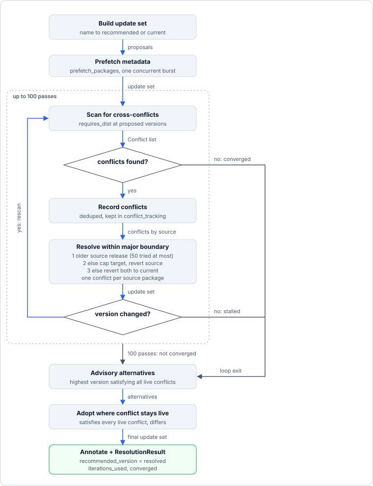

# Conflict Resolution

`VersionChecker` decides each package in isolation. Those decisions can be mutually inconsistent:
upgrading `flask` to `2.3.3` requires `Werkzeug>=2.3.7`, but your file may cap `werkzeug` at
`<2.3`. `DependencyAnalyzer` finds and repairs such pairs.

Enabled by default. Disable with `--no-check-conflicts` or `check_conflicts = false`.

---

## What is checked

For every package *P* at its proposed version *V*, depkeeper fetches *V*'s `requires_dist` and,
for each dependency *D* **that also appears in your requirements file**, verifies that *D*'s
proposed version satisfies *P*'s specifier. A package's requirement on itself is ignored.

## What is not checked

| Not checked | Why |
|---|---|
| Dependencies absent from your file | depkeeper cannot adjust what you did not declare, so it cannot be a resolvable conflict. |
| Transitive dependencies | Only direct `requires_dist` of the proposed versions is read; the graph is not expanded. |
| Extra-conditional dependencies | Entries carrying a `; extra == "..."` marker evaluate false with `extra` empty and are skipped. |
| Environment-marker-conditional dependencies | Markers are evaluated with `python_version` / `python_full_version` set to the **target Python** (`X.Y` and `X.Y.0`) and every other marker (platform, etc.) taken from the host, with `extra` empty; a dependency whose marker is false there is skipped, so a Windows-only dependency is ignored on Linux. The marker is then stripped. |
| Build-time requirements | `requires_dist` only. |

**depkeeper is not a substitute for `pip`'s resolver.** Always install and test the result.

---

## Algorithm

<p align="center"></p>

*Up to 100 passes; a pass that changes nothing stops the loop early (stalled).*

### Phase 1 — Initialise

The **update set** maps every package name to `recommended_version or current_version`. Because
recommendations already respect the major boundary, the loop starts from a safe position.
The initial values are also copied to `original_versions` so the final report can show
`original → resolved` after the set has been rewritten in place.

### Phase 2 — Detect

For each package at its proposed version, `requires_dist` is parsed with
`packaging.requirements.Requirement`. Unparseable entries are logged at DEBUG and skipped — one
malformed upstream specifier never blocks the analysis. A `Conflict` records the source package,
its version, the target package, the required specifier and the violating version.

Names on both sides are canonicalised with PEP 503 rules. This is essential: upstream metadata
spells names however the author typed them (`zope.interface`), while the update set is keyed by
the parser's canonical form (`zope-interface`). One shared normaliser is the only reason
dotted-name conflicts are detected at all.

### Phase 3 — Resolve, within boundaries

For each unique **source** package in the conflict list, two strategies are tried in order.
Only one conflict per source package is processed per pass, and sources are visited in name order, so the
result does not depend on the order of the files.

**Strategy 1 — step the source back.** Walk the source's releases newest-first, within its
boundary, and stop at the first version whose requirement on the target is satisfied by the
target's proposed version (or which does not depend on the target at all). The walk honours the
source's own retained specs, the target Python, and the checker's policy (hold, `max_update`,
`min_age`, pre-release rule), stops below the installed version, and evaluates at most 50 candidates. A candidate must also satisfy its
requirements on every *other* proposed package, so a step back cannot trade one conflict for another.

**Strategy 2 — constrain the target.** Find the highest release of the target, within the
target's boundary and under the same retained-spec and policy filters, that satisfies the source's
specifier, and revert the source to its current version. The candidate must also satisfy what
every other proposed package requires of the target, and the target's own requirements on the proposals.
A package that is **held** or **ignored** is never lowered this way.

The *boundary* is the current major for semver packages, and unbounded for calver packages and
for packages opted in with `--allow-major`.

**Fallback.** If neither succeeds, **both** packages revert to their current versions (those that
have one) and a `WARNING` is logged:

```text
No compatible version found for flask ↔ werkzeug within major boundaries; reverting both
```

Reverting is the safe outcome: it produces no change rather than a change that may not install.

### Phase 4 — Terminate

| Condition | Outcome |
|---|---|
| No conflicts detected in a pass | `converged = True` |
| A pass moves the update set back to a state already seen | Loop stops early (`cycling`) with a `WARNING`. |
| A pass changes nothing | Loop stops early (`stalled`) with a `WARNING`; `converged = False`, since conflicts remained. |
| 100 passes elapse | A `WARNING` is logged. |

`converged` is decided on the **final** set: it is `True` exactly when no package in it violates a
requirement of another, even if the loop stalled, cycled or ran out of passes and an advisory
alternative (below) repaired the rest.

`iterations_used` and `converged` are reported in the Resolution Summary.

### Phase 5 — Advisory alternatives

`conflict_tracking` is **cumulative** and internal: it holds every conflict seen in any pass,
including ones a later pass resolved. (The conflicts shown to you per package are the live subset
for the final update set, each listed once.) For each package with recorded conflicts, depkeeper computes the highest
version — within its major, not below its current version — that satisfies *all* recorded
specifiers intersected together. This is `compatible_alternative`.

It is **advisory**. It is adopted into the applied version only when:

1. the package still has a **live** conflict, and
2. the alternative satisfies every live conflict, and
3. it differs from the currently proposed version, and
4. adopting it introduces no conflict the current set does not already have.

A conflict is *live* when the source package is still headed for the recorded `source_version`
**and** the target's final version still fails the required specifier. Conflicts a later pass
resolved are history and must not influence what is written.

Every alternative and every liveness test is computed from a single pre-adoption snapshot, so the
outcome does not depend on package ordering. Adoption is logged at INFO.

---

## Result invariant

After `resolve_and_annotate_conflicts` returns:

```text
package.recommended_version == result.resolved_versions[package.name].resolved
```

`ResolutionResult` is the single source of truth. The version printed in the summary is always
the version `depkeeper update` writes. Any divergence is a bug — this invariant exists because an
earlier implementation wrote `recommended_version` twice and could report one version while
writing another.

---

## Resolution statuses

Each package receives a `ResolutionStatus`:

| Status | Meaning |
|---|---|
| `kept_recommended` | The original proposal was already conflict-free. |
| `upgraded` | Resolution moved the package **higher** than first proposed. |
| `downgraded` | Resolution moved it lower, and conflicts were recorded for it. |
| `kept_current` | The resolved version equals the installed version — no safe upgrade was found. |
| `constrained` | The version was dictated by another package's requirement (no conflict recorded against this package itself). |

---

## Worked example

```text
flask>=2.3,<3.0
werkzeug>=2.2,<2.3
```

`flask 2.3.3` requires `Werkzeug>=2.3.0`, but your file caps `werkzeug` below `2.3`.

```bash
depkeeper check conflict.txt
```

Real output (the table trimmed of its `Python Support` column):

```text
WARNING: No compatible version found for flask ↔ werkzeug within major boundaries; reverting both
WARNING: No compatible version found for flask ↔ werkzeug within major boundaries; reverting both
WARNING: Conflict resolution stalled after 2 iteration(s)

Resolution Summary:
==================================================
Total packages: 2
Packages with conflicts: 1
Packages changed: 2
Converged: No (stopped after 2 iterations)

Version changes:
  • flask: 2.3.3 → 2.3 (kept_current)
  • werkzeug: 2.2.3 → 2.2 (kept_current)

┏━━━━━━━━━━━━┳━━━━━━━━━━┳━━━━━━━━━┳━━━━━━━━┳━━━━━━━━━━━━━┳━━━━━━━━━━━━━┳━━━━━━━━━━━━━━━━━━━━━━━┓
┃   Status   ┃ Package  ┃ Current ┃ Latest ┃ Recommended ┃ Update Type ┃ Conflicts             ┃
┡━━━━━━━━━━━━╇━━━━━━━━━━╇━━━━━━━━━╇━━━━━━━━╇━━━━━━━━━━━━━╇━━━━━━━━━━━━━╇━━━━━━━━━━━━━━━━━━━━━━━┩
│    [OK]    │ flask    │   2.3   │ 3.1.3  │      -      │      -      │ -                     │
│ [CONFLICT] │ werkzeug │   2.2   │ 3.1.9  │      -      │   blocked   │ ⚠ flask needs >=2.3.0 │
└────────────┴──────────┴─────────┴────────┴─────────────┴─────────────┴───────────────────────┘
```

Read this carefully:

- Each package's inferred current version is its floor: `flask 2.3`, `werkzeug 2.2`. The initial
  proposals were `flask 2.3.3` (the newest 2.x allowed) and `werkzeug 2.2.3`.
- Strategy 1 found no `flask` release at or above `2.3` that accepts `werkzeug 2.2.3`; strategy 2
  found no `werkzeug` below `2.3` that satisfies `>=2.3.0`. So **both reverted** to their current
  versions. `Version changes` therefore prints `2.3.3 → 2.3` (original proposal to the reverted
  current version) with status `kept_current`: nothing will be written.
- The pass that changed nothing made the loop stop as stalled, so `Converged: No`. No update is
  applied, but your file itself is in conflict (`flask>=2.3` needs `werkzeug>=2.3.0`; you capped it at `<2.3`). The `Conflicts`
  column keeps `⚠ flask needs >=2.3.0` as the audit trail.
- The `Version changes` arrow can look odd for this reason. It shows proposal to outcome, not
  declared to outcome.

To let `flask` move, raise the werkzeug cap yourself:

```text
flask>=2.3,<3.0
werkzeug>=2.3.0,<3.0
```

---

## Downgrades

A downgrade is proposed when the declared version cannot be used:

- another package in the file requires an older release, or
- the declared version is not compatible with the target Python.

Downgrades render as `[INCOMP]` in the table, `downgrade` in JSON, and `downgrade` in the update
plan's `Change` column. They **are** applied by `update`. If you do not want that, run with
`--no-check-conflicts` and resolve manually, or exclude the package with `--packages`.

---

## Failure and degradation modes

| Condition | Behaviour |
|---|---|
| PyPI metadata for a package unavailable during resolution | Logged once at WARNING, name negatively cached for the run, both search strategies return `None`, fallback reverts both packages. The run continues. |
| Malformed `requires_dist` entry | Logged at DEBUG, skipped. |
| Unparseable required specifier | Treated as satisfied. Malformed upstream metadata can never veto a version on its own. |
| Source package has several conflicts | Only one is processed per pass. A source whose first conflict is unresolvable can hide a second, satisfiable one. |
| Resolution does not converge in 100 passes | The final set is rescanned; remaining conflicts are reported and `converged: No` is shown. The update set is applied as-is. |
| A package has no current version | It has no major anchor, so both boundary-aware searches return nothing for it; it keeps the checker's recommendation. |

The negative cache exists to prevent a retry storm: without it, an unreachable package would be
re-requested — with full retry and backoff — on each of up to 100 passes.

> [!NOTE]
> **Negative caching is analyzer-local**
>
> The `PyPIDataStore` itself never caches failures, because `prefetch_packages` swallows errors
> and the checker legitimately retries afterwards. Sticky failures there would regress recovery
> from transient errors.

---

## Cost

| Operation | Requests |
|---|---|
| Prefetch | 1 per unique package |
| Conflict scan | 1 per `(package, proposed version)` pair not already cached |
| Source-version walk | up to 50 per conflict, each a `/pypi/{pkg}/{version}/json` call, cached thereafter |

Everything is memoised for the process lifetime, so later passes are almost free. In pathological
cases — many packages, many conflicts, a resolver that keeps moving versions — a run can still
issue hundreds of requests. `--no-check-conflicts` removes this entirely and is the right choice
when you only need an update report. See [Operations](../guides/operations.md#performance).

---

## When to disable it

| Situation | Recommendation |
|---|---|
| Fast "what's outdated" report in CI | `--no-check-conflicts` |
| Requirements file with one or two packages | Either; the cost is negligible |
| Applying updates to a real project | Keep it enabled |
| Debugging a strange recommendation | Run both ways and compare; a difference isolates the resolver |
| Rate-limited or flaky network | `--no-check-conflicts` reduces request volume substantially |
