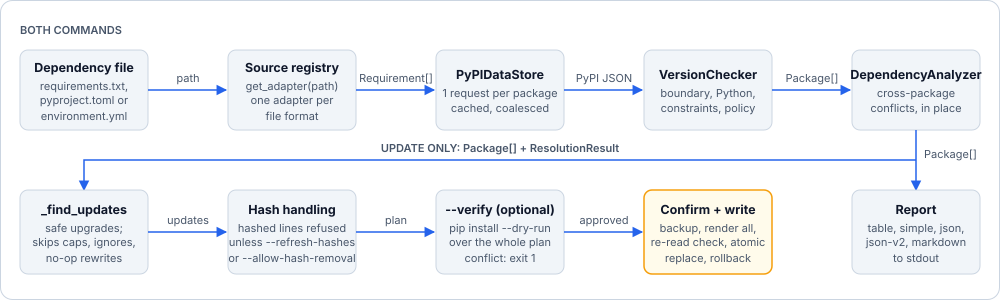

# Core Concepts

These pages describe *how depkeeper thinks*. They are the reference for anyone who needs to
predict, justify or debug a recommendation, and the prerequisite reading for contributors.

- **[Architecture](architecture.md)** — Module responsibilities, the request pipeline, and the design decisions behind them.
- **[Version recommendation](version-recommendation.md)** — How a single package's target version is chosen: boundaries, filters and inference.
- **[Conflict resolution](conflict-resolution.md)** — The iterative resolver, its strategies, its guarantees and its failure modes.
- **[Requirements parsing](requirements-parsing.md)** — What the parser accepts, what it ignores, and what it cannot represent.
- **[Write safety](write-safety.md)** — Atomic writes, outside-modification check, multi-file rollback, backups, encoding and line-ending preservation.

---

## The pipeline in one diagram

Both commands run the same pipeline up to the report. `update` adds optional hash refresh and `--verify`, then the write.

*Both commands share the first four stages and the report; only `update` reaches the write.*

| Stage | Component | Responsibility |
|---|---|---|
| Parse | Source adapter (`RequirementsParser` for `requirements.txt`) | File → `Requirement` objects; `-r` / `-c` resolution for requirements files. |
| Fetch | `PyPIDataStore` | One HTTP request per package per process; caching and coalescing. |
| Recommend | `VersionChecker` | Per-package target version under boundary, Python, constraint, policy and cooldown filters. |
| Resolve | `DependencyAnalyzer` | Cross-package consistency; mutates recommendations in place. |
| Render | `commands.check` / `commands._report` | Table / simple / json / json-v2 / markdown, with stream separation. |
| Verify (optional) | `core.verify` | `update --verify`: pip dry-run over the proposed set before writing. |
| Write | `commands.update` | Minimal-edit, atomic, rollback-capable rewrite via the source adapter. |

---

## Non-negotiable invariants

These hold across the whole system. Contributors must not break them; operators can rely on them.

| # | Invariant | Enforced by |
|---|---|---|
| 1 | A recommendation never crosses a major version boundary when a current version is known, unless the package is opted in (`--allow-major` / `allow_major`) or is calver. | `VersionChecker._build_package_from_data`, `DependencyAnalyzer` search helpers |
| 2 | A recommendation never violates the constraints declared in the file or its `-c` files, including the bound implied by `~=` (unless `--pin`). | `VersionChecker._filter_by_constraints`, `_find_updates`, `Requirement.update_version` |
| 3 | A pre-release is never recommended unless the package sets `allow_prerelease`. | `PyPIPackageData.get_python_compatible_versions` |
| 4 | `Package.recommended_version` equals `ResolutionResult.resolved_versions[name].resolved`. | `DependencyAnalyzer.resolve_and_annotate_conflicts` |
| 5 | Package names are compared only in PEP 503 canonical form. | `depkeeper.utils.naming.normalize_package_name` |
| 6 | `check` never writes to the filesystem. | No write path is imported by `commands.check` |
| 7 | A failed or interrupted write leaves every affected file at its previous content, and a file changed by someone else during the run is refused. | `_commit_pending_writes` / `_rollback_writes` |
| 8 | Machine-readable formats (`json`, `json-v2`, `markdown`, `simple`) never emit non-payload bytes on stdout. | `_status_stream_is_stderr` + per-stream consoles |

---

## Terminology

| Term | Definition |
|---|---|
| **Requirement** | One declared dependency: a requirements line, a TOML entry or a conda item. |
| **Package** | A requirement enriched with PyPI metadata and version decisions. |
| **Current version** | The version inferred from the requirement's specifiers. |
| **Recommended version** | The version depkeeper would write. |
| **Retained specs** | The specifiers that survive a rewrite unchanged: upper bounds, exclusions, wildcard bands. |
| **Target Python** | The Python version candidates must support: flag, config, file `requires-python`, else the running interpreter. |
| **Update set** | The resolver's working map of package name → proposed version. |
| **Live conflict** | A recorded conflict that the *final* update set still violates. |
| **Unavailable stub** | A `Package` created when PyPI metadata could not be fetched. |
